# Post-contenido — Unidad 11: Buenas Prácticas y Patrones de Diseño

**Estudiante:** Santiago Carreño Calceto
**Asignatura:** Programación Web — Séptimo Semestre
**Repositorio:** `carreno-post1-u11`

## Descripción

Repositorio del laboratorio de la Unidad 11. Contiene un único proyecto Maven Spring Boot (**`pedidos/`**, paquete raíz `com.tienda.pedidos`). El punto de partida es un código con violaciones reales de SOLID (SRP y DIP), SQL embebido y la entidad JPA expuesta directamente en la API.

En la Parte 1 ese código se refactoriza aplicando arquitectura en capas, el patrón DTO, inyección de dependencias por constructor y el patrón **Strategy** para el descuento por tipo de cliente. En la Parte 2 se extiende con manejo centralizado de errores (`@RestControllerAdvice`), logging con SLF4J/Logback y documentación de la API con springdoc-openapi/Swagger.

El historial de commits conserva el **código de partida** (primer commit) y cada paso de la refactorización. Todos los commits compilan.

| Parte | Commits |
|-------|---------|
| **Parte 1** | 1. código de partida · 2. DTOs + `PedidoRepository` (sin SQL) · 3. `PedidoService` con DIP · 4. Strategy · 5. pruebas (tag `parte-1`) |
| **Parte 2** | 6. springdoc-openapi · 7. `GlobalExceptionHandler` · 8. SLF4J + `logback-spring.xml` · 9. anotaciones de Swagger · 10. pruebas · README |

## Tecnologías

- Java 17 (probado con JDK 21) y Spring Boot 3.2.12
- Spring Web, Spring Data JPA, Bean Validation y H2 en memoria
- SLF4J + Logback (incluido en `spring-boot-starter-web`)
- springdoc-openapi-starter-webmvc-ui 2.3.0 (OpenAPI 3 + Swagger UI)
- JUnit 5, Mockito y MockMvc (22 pruebas)

---

## Código de partida: violaciones identificadas y cómo se corrigió cada una

| # | Violación en el código de partida | Corrección |
|---|-----------------------------------|------------|
| 1 | **SRP**: `crearPedido` validaba, calculaba el descuento, armaba el SQL, persistía, notificaba y registraba en un solo método (seis responsabilidades). | Cada responsabilidad tiene su clase. `PedidoController` solo traduce HTTP ↔ DTO; la validación es declarativa en `PedidoRequestDTO` (`@Valid`); `PedidoServiceImpl` orquesta; el descuento vive en las estrategias; `PedidoRepository` persiste; `NotificacionService` notifica; SLF4J registra. |
| 2 | **DIP**: `new NotificacionEmailService()` dentro del controller. | `NotificacionService` (interfaz) + `NotificacionEmailServiceImpl` (`@Service`), inyectada por **constructor** en `PedidoServiceImpl`. El controller depende de la interfaz `PedidoService`. Ninguna clase crea sus colaboradores con `new`, así que en las pruebas se reemplazan por mocks. |
| 3 | **Sin capa de datos / inyección SQL**: `INSERT` y `SELECT` concatenados con `JdbcTemplate` en el controller. | `PedidoRepository extends JpaRepository<Pedido, Long>` (+ `findByClienteEmail`). No queda **ninguna** sentencia SQL escrita a mano en el proyecto. JPA usa parámetros, nunca concatenación. |
| 4 | **Entidad expuesta**: la API devolvía `Pedido` completo, incluido `notasInternas`. | `PedidoRequestDTO` (entrada, con `@NotBlank`, `@Email`, `@NotNull`, `@Positive`) y `PedidoResponseDTO` (salida, **sin** `notasInternas` ni `fechaCreacion`), con mapeo explícito en `toResponseDTO()`. |
| 5 | **Errores silenciados**: `try/catch` con `println` y `return null`, así que un id inexistente respondía **200 vacío**. | El controller no captura nada. `RecursoNoEncontradoException` sube a `GlobalExceptionHandler` (`@RestControllerAdvice`), que responde **404** con un `ApiError`. |
| 6 | **Descuento con `if / else if / else`** en el controller (cerrado a extensión). | Patrón **Strategy**: `EstrategiaDescuento` + `DescuentoRegular` / `DescuentoVip` / `DescuentoMayorista`, inyectadas como `Map<String, EstrategiaDescuento>`. |
| 7 | **`System.out.println`** como log. | SLF4J con placeholders `{}` y niveles DEBUG/INFO/WARN/ERROR. Logback escribe en consola y en `logs/pedidos.log`. No queda ningún `println`. |

Así se comportaba el código de partida, ejecutado desde el primer commit:

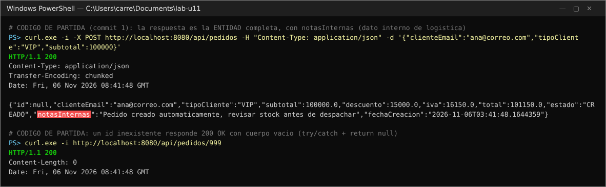

## Arquitectura resultante

```
                     HTTP (JSON)
                          │
┌─────────────────────────▼──────────────────────────┐
│ controller/PedidoController   @RestController      │  @Valid PedidoRequestDTO → PedidoResponseDTO
│   depende de ─► PedidoService (interfaz)           │  sin lógica, sin try/catch
└─────────────────────────┬──────────────────────────┘
                          │ (DIP)
┌─────────────────────────▼──────────────────────────┐
│ service/PedidoServiceImpl   @Service               │  orquesta: estrategia → IVA → guardar → notificar
│   + PedidoRepository            (constructor)      │  toResponseDTO(): mapeo explícito entidad → DTO
│   + NotificacionService         (constructor)      │
│   + Map<String,EstrategiaDescuento> (constructor)  │
└──────┬───────────────────┬──────────────────┬──────┘
       │                   │                  │
┌──────▼───────────┐ ┌─────▼──────────────┐ ┌─▼──────────────────────────────┐
│ repository/      │ │ service/           │ │ strategy/EstrategiaDescuento   │
│ PedidoRepository │ │ NotificacionService│ │  ├─ @Component("REGULAR") 0 %  │
│ extends          │ │  └─ Notificacion-  │ │  ├─ @Component("VIP")    15 %  │
│ JpaRepository    │ │     EmailService-  │ │  └─ @Component("MAYORISTA") 25%│
└──────┬───────────┘ │     Impl           │ └────────────────────────────────┘
       │             └────────────────────┘
┌──────▼───────────┐   dto/PedidoRequestDTO   (entrada, Bean Validation + @Schema)
│ entity/Pedido    │   dto/PedidoResponseDTO  (salida, sin notasInternas)
│ (@Entity, H2)    │   exception/RecursoNoEncontradoException
└──────────────────┘   exception/GlobalExceptionHandler (@RestControllerAdvice) → exception/ApiError
```

```
pedidos/src/main/java/com/tienda/pedidos/
├── PedidosApplication.java            (@OpenAPIDefinition)
├── controller/   PedidoController.java
├── service/      PedidoService.java · PedidoServiceImpl.java · NotificacionService.java · NotificacionEmailServiceImpl.java
├── repository/   PedidoRepository.java
├── dto/          PedidoRequestDTO.java · PedidoResponseDTO.java
├── entity/       Pedido.java
├── strategy/     EstrategiaDescuento.java · DescuentoRegular.java · DescuentoVip.java · DescuentoMayorista.java
└── exception/    ApiError.java · GlobalExceptionHandler.java · RecursoNoEncontradoException.java
pedidos/src/main/resources/   application.properties · logback-spring.xml
```

---

## Parte 1 — Refactorización con SOLID, DTO y Strategy

### Checkpoint 1: DTOs y PedidoRepository (DAO)

`PedidoRequestDTO` tiene `@NotBlank` en `clienteEmail` y `tipoCliente`, y `@Positive` en `subtotal`. Además lleva `@NotNull` en `subtotal`, porque `@Positive` acepta `null` y un `{}` habría llegado al servicio como un `NullPointerException`; también lleva `@Email`. `PedidoResponseDTO` no declara `notasInternas`. `PedidoRepository` extiende `JpaRepository`. En ese mismo commit el controller de partida dejó de usar `JdbcTemplate`.

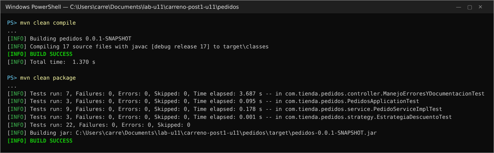

### Checkpoint 2: PedidoService con DIP

`PedidoServiceImpl` recibe `PedidoRepository`, `NotificacionService` y el mapa de estrategias **por constructor**. El controller solo conoce la interfaz `PedidoService`. La prueba `PedidoServiceImplTest` demuestra el beneficio de DIP: el servicio se prueba sin Spring ni base de datos, con el repositorio y la notificación como mocks de Mockito (con el `new` del código de partida, eso era imposible).

### Checkpoint 3: Strategy funcionando con los tres tipos de cliente

`POST /api/pedidos` con `{"clienteEmail":"ana@correo.com","tipoCliente":"VIP","subtotal":100000}` responde **201** con `descuento=15000`, `iva=16150`, `total=101150` y sin `notasInternas`. Con `MAYORISTA` el descuento es 25000 y con `REGULAR` es 0. Un tipo desconocido (`ORO`) usa la estrategia `REGULAR` y deja un `WARN` en el log.

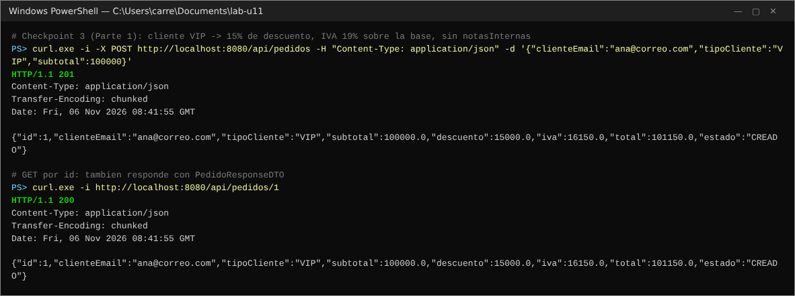
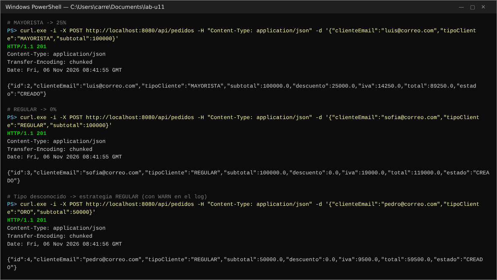

### Decisiones de diseño — Parte 1

1. **Strategy en vez de un segundo patrón creacional (Factory) para la conversión a DTO.** El descuento tiene variación real de comportamiento según `tipoCliente` y puede crecer. Un tipo `CORPORATIVO` futuro es solo una clase nueva con `@Component("CORPORATIVO")`, sin tocar `PedidoServiceImpl` (OCP). La conversión entidad → DTO, en cambio, es un mapeo 1:1 sin lógica, así que se resuelve con un método privado `toResponseDTO()` y no con una clase Mapper/Factory adicional (DRY, sin abstracciones innecesarias).
2. **`JpaRepository` en vez de mantener `JdbcTemplate`.** Elimina la inyección SQL del código de partida y las sentencias que había que mantener a mano sincronizadas con la entidad. Las consultas derivadas (`findByClienteEmail`) se generan del nombre del método con seguridad de tipos.
3. **Montos redondeados a 2 decimales (`BigDecimal`, `HALF_UP`)** en descuento, IVA y total, para que un subtotal con decimales no deje residuos de punto flotante en la respuesta.
4. **Tipo de cliente desconocido → `REGULAR` + `WARN`.** Un valor inesperado no rompe la compra. El caso queda registrado como situación inusual, y en la respuesta aparece el tipo realmente aplicado (`REGULAR`).

---

## Parte 2 — Manejo de Errores, Logging y Documentación

### Checkpoint 1: GlobalExceptionHandler con @RestControllerAdvice

| Excepción | Respuesta |
|-----------|-----------|
| `RecursoNoEncontradoException` | **404** `{"status":404,"error":"Not Found","mensaje":"Pedido con id 999 no encontrado.",...}` |
| `MethodArgumentNotValidException` | **400** con cada campo inválido: `"clienteEmail: El email del cliente es obligatorio; ..."` |
| `HttpMessageNotReadableException`, `MethodArgumentTypeMismatchException` | **400** (JSON mal formado o id no numérico: error del cliente, no del servidor) |
| `NoResourceFoundException` / `HttpRequestMethodNotSupportedException` | **404** / **405** |
| `Exception` | **500** con un mensaje genérico. El detalle y el stack trace van solo al log (`ERROR`). |

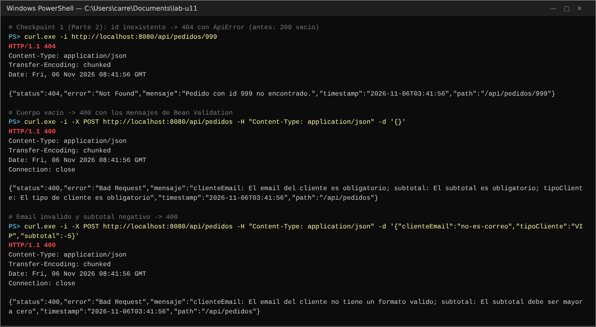

### Checkpoint 2: SLF4J y Logback

`PedidoServiceImpl` registra con placeholders `{}`:

- **INFO**: creación del pedido, descuento aplicado y pedido guardado (con su id).
- **DEBUG**: búsqueda por id.
- **WARN**: pedido no encontrado o tipo de cliente desconocido.

`GlobalExceptionHandler` registra **WARN** para los datos inválidos y **ERROR** (con stack trace) para los errores inesperados. `logback-spring.xml` define un appender de **consola** (`HH:mm:ss`) y un **RollingFileAppender** en `logs/pedidos.log` con fecha completa, rotación diaria (`pedidos.%d{yyyy-MM-dd}.log`) y `maxHistory` de 30 días. La carpeta `logs/` está en `.gitignore`.

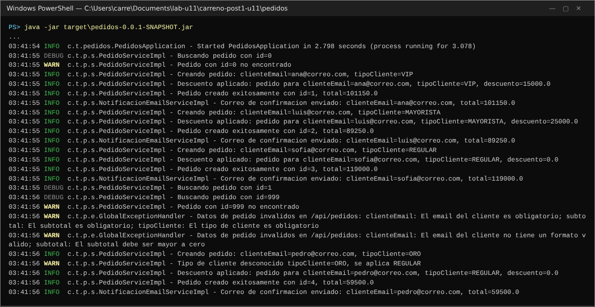
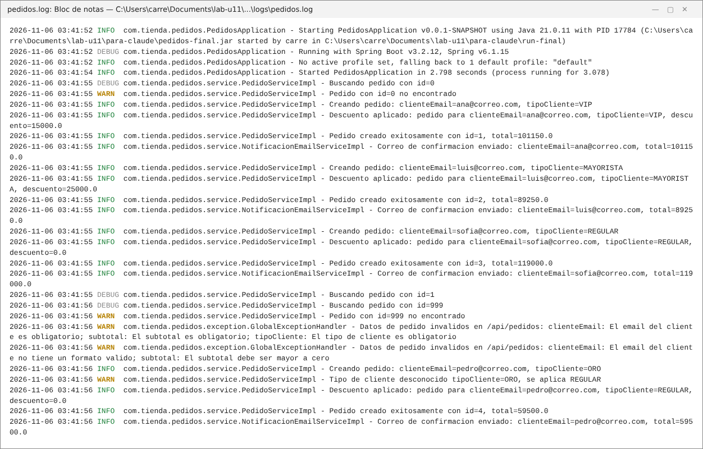

### Checkpoint 3: springdoc-openapi y Swagger UI

`@OpenAPIDefinition` en `PedidosApplication`, `@Tag` en el controller, `@Operation` + `@ApiResponse` (201/200, 400 y 404, con el esquema `ApiError` en los errores) y `@Parameter` en el id, y `@Schema` con descripción, ejemplo y `allowableValues` en `PedidoRequestDTO`. Swagger UI está en `http://localhost:8080/swagger-ui.html` y el JSON de OpenAPI en `/api-docs`.

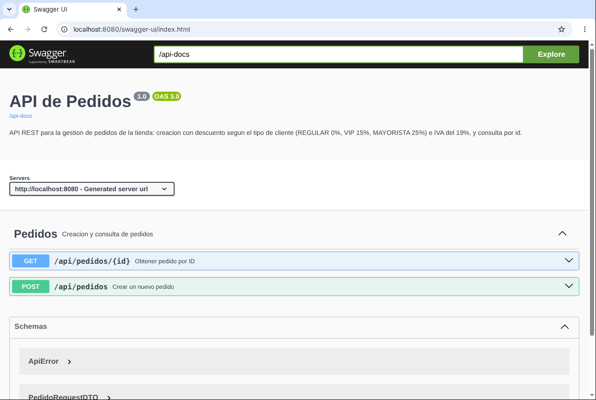
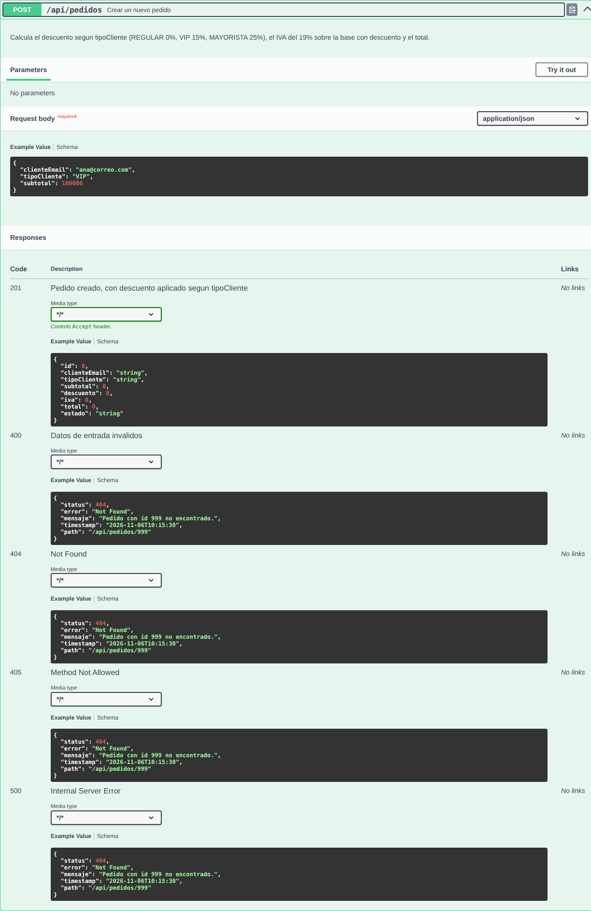
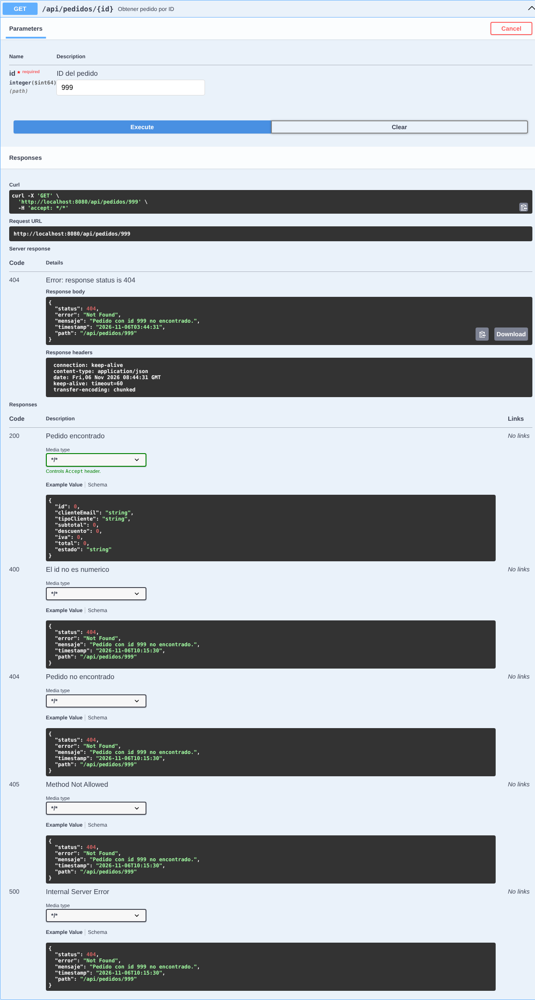
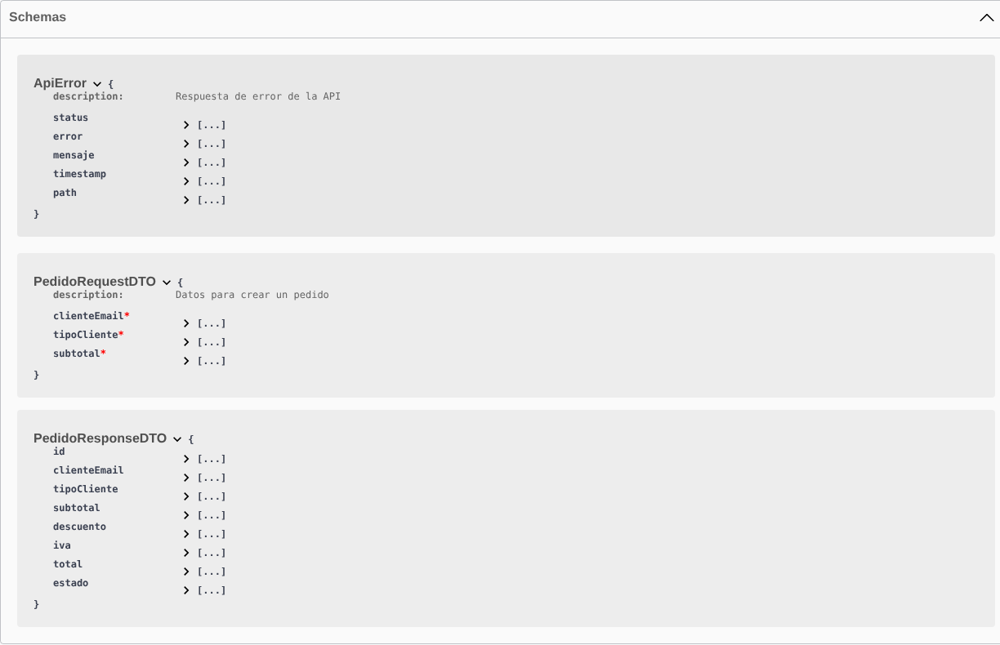

### Decisiones de diseño — Parte 2

1. **El registro del descuento aplicado vive en el servicio, no en cada Strategy.** Un solo `INFO` en `PedidoServiceImpl`, justo después de invocar la estrategia, con `tipoCliente` y monto. Así hay un único punto de auditoría por pedido, en vez de un rastro repartido en tres clases.
2. **`notasInternas` nunca se registra en los logs** (ni se expone en el DTO). Es información operativa de logística, y un archivo de log puede compartirse con soporte o quedar retenido 30 días. Los mensajes solo llevan id, clienteEmail, tipoCliente y montos. La prueba en el PC verificó que ni la consola ni `logs/pedidos.log` contienen ese texto.
3. **Handlers explícitos para los errores del cliente** (JSON mal formado, id no numérico, ruta inexistente). Sin ellos, el handler genérico de `Exception` los convertiría en **500**, culpando al servidor por un error de quien hace la petición.
4. **El 500 nunca devuelve el mensaje de la excepción.** El cliente recibe "Error inesperado. Contactar soporte." y el detalle técnico queda solo en el log de nivel ERROR.

---

## Pruebas automáticas (22)

| Clase | Pruebas | Qué verifica |
|-------|---------|--------------|
| `EstrategiaDescuentoTest` | 3 | 0 %, 15 % y 25 % |
| `PedidoServiceImplTest` (Mockito) | 9 | Las tres estrategias e insensibilidad a mayúsculas, tipo desconocido, redondeo, `notasInternas` guardado pero no devuelto, 404 del servicio |
| `PedidosApplicationTest` | 3 | El `Map` de Spring tiene exactamente REGULAR/VIP/MAYORISTA; POST 201 sin `notasInternas`; GET por id |
| `ManejoErroresYDocumentacionTest` | 7 | 404/400 con `ApiError`, JSON mal formado e id no numérico → 400, `/api-docs` con las respuestas 201/400/404 y los `allowableValues`, Swagger UI disponible |

## Cómo compilar y ejecutar

1. Clonar el repositorio: `git clone https://github.com/SantiagoCalceto/carreno-post1-u11.git`
2. Ejecutar dentro de `pedidos/`: `./mvnw spring-boot:run` (Windows: `mvnw.cmd spring-boot:run`). Usa H2 en memoria, no hay que instalar ninguna base de datos.
3. Probar los endpoints con Postman o curl en `http://localhost:8080/api/pedidos`:
   ```
   curl -X POST http://localhost:8080/api/pedidos -H "Content-Type: application/json" -d "{\"clienteEmail\":\"ana@correo.com\",\"tipoCliente\":\"VIP\",\"subtotal\":100000}"
   curl -i http://localhost:8080/api/pedidos/1
   curl -i http://localhost:8080/api/pedidos/999
   ```
4. Consultar los logs en consola y en `pedidos/logs/pedidos.log`.
5. Abrir la documentación interactiva en `http://localhost:8080/swagger-ui.html`.
6. Pruebas: `./mvnw test`.

## Capturas de pantalla

Las respuestas HTTP y los logs son la salida real de la aplicación ejecutada en el PC (curl.exe, consola y `logs/pedidos.log`). Las de Swagger UI se tomaron con el mismo `.jar` en un navegador.

| Captura | Muestra |
|---------|---------|
| [antes-codigo-partida.png](capturas/antes-codigo-partida.png) | Código de partida: entidad con `notasInternas` y 200 vacío para un id inexistente |
| [compilacion.png](capturas/compilacion.png) | `mvn clean compile` y `mvn clean package` (22 pruebas) en BUILD SUCCESS |
| [post-exitoso.png](capturas/post-exitoso.png) | POST VIP: 201 con descuento=15000, iva=16150, total=101150 |
| [strategy-tres-tipos.png](capturas/strategy-tres-tipos.png) | MAYORISTA (25000), REGULAR (0) y tipo desconocido |
| [errores-api.png](capturas/errores-api.png) | 404 y 400 con `ApiError` |
| [logs-consola.png](capturas/logs-consola.png) | Logs en consola (DEBUG/INFO/WARN) |
| [logs-archivo.png](capturas/logs-archivo.png) | `logs/pedidos.log` con fecha completa |
| [swagger-ui.png](capturas/swagger-ui.png) | Swagger UI con el grupo "Pedidos" |
| [swagger-post-detalle.png](capturas/swagger-post-detalle.png) / [swagger-get-404.png](capturas/swagger-get-404.png) / [swagger-schemas.png](capturas/swagger-schemas.png) | Endpoints expandidos, Try it out y esquemas |
